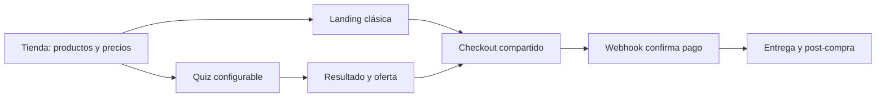

# Offer Creator: tiendas, landings y quiz

Documento de referencia de la implementación local. Actualizado el 16 de noviembre de 2026. No implica un despliegue en producción.

## Explicado simple

La **tienda** es la caja que contiene qué vendemos y cuánto cuesta. Las **landings** son dos puertas de entrada a esa caja. El **checkout** es la caja registradora compartida.

1. Se crean productos y sus archivos de entrega.
2. En la tienda se eligen producto principal, bonos, extras y oferta post-compra.
3. Se prepara una landing clásica, un quiz o ambas experiencias.
4. Cada landing se guarda y publica por separado.
5. El visitante entra directamente a la oferta o responde el quiz y ve su resultado.
6. Ambos caminos llegan al mismo checkout, con los precios calculados en el servidor.
7. El webhook de pago confirma la compra; después se habilitan entrega y post-compra.

## Rutas y publicación

| Ruta pública | Contenido |
| --- | --- |
| `/` | Landing clásica publicada |
| `/quiz` | Portada y recorrido del quiz |
| `/quiz/resultado` | Resultado de la sesión del visitante |
| `/checkout` | Checkout compartido; admite acceso directo |

Las mismas rutas funcionan con el prefijo `/l/:subdomain`. Las rutas anteriores del editor clásico siguen disponibles. La dirección pública pertenece a la tienda y se comparte entre ambas landings.

Una tienda admite una landing de cada tipo: `classic` y `quiz`. Publicar únicamente el quiz habilita el checkout. Despublicar un tipo no despublica el otro. Despublicar el quiz bloquea nuevas sesiones y la continuación pública, conservando publicaciones históricas, respuestas y compras.

## Configuración del quiz simplificada

En **Tienda → Landings** hay tarjetas para Clásica y Quiz con estado, enlace, editor, vista previa, publicación y despublicación.

El editor del quiz tiene tres apartados:

- **Contenido:** lista de pantallas cerradas. Abrir una permite editar título, explicación, opciones e imagen. Las flechas reordenan; también se puede agregar, duplicar y eliminar. El resultado y la oferta final están al final de la lista.
- **Diseño:** marca, logo y colores; dirección y enlaces legales dentro de opciones adicionales.
- **Avanzado:** cálculos, condiciones y perfiles. Las opciones detalladas de cada pantalla permanecen dentro de un desplegable.

Los botones principales son **Guardar borrador**, **Probar quiz** y **Publicar quiz**. No es necesario configurar fórmulas para tener un quiz funcional.

### Generar con IA

El asistente destacado usa el mismo servicio de IA del servidor que la landing clásica:

1. Público: para quién es el quiz.
2. Objetivo: qué queremos descubrir del visitante.
3. Cantidad de preguntas (5, 7 o 12) y tono.

El servidor agrega nombre y descripción del producto principal. Devuelve una propuesta con portada, preguntas, intermedios, captura de contacto y resultado. Se puede recorrer la propuesta antes de pulsar **Usar y guardar borrador**.

La propuesta reemplaza el recorrido del borrador: elimina reglas, cálculos y perfiles anteriores que dependían de sus preguntas. Conserva identidad, configuración de contacto y bloques comerciales compatibles. El aviso se muestra antes de generar y aplicar. La versión publicada se conserva hasta publicar nuevamente.

La acción de IA no guarda ni publica por sí sola. Su salida pasa por la validación del motor. Una respuesta inválida o un fallo del proveedor mantiene el borrador anterior. Requiere `OPENAI_API_KEY`; `OPENAI_MODEL` es opcional y comparte el valor predeterminado del servidor. Sin credenciales, el formulario manual sigue funcionando.

No se generan imágenes, testimonios, estadísticas, fórmulas de salud ni modificaciones de precios. La IA redacta una presentación de los productos existentes; no crea un producto personalizado.

## Pantallas y reglas

El motor admite portada, selección simple y múltiple, texto, número, medidas con unidades, fecha, explicación con medios, contacto, resumen y transición. Las opciones pueden tener imagen, icono, descripción y puntuación. Hay avance automático configurable, selección exclusiva, mínimos y máximos.

Los resultados admiten texto, imagen, video, respuestas, indicadores, escala, comparación, gráficos de líneas/barras y bloques comerciales (beneficios, oferta, testimonios, preguntas frecuentes, garantía y promoción). Los gráficos incluyen una tabla accesible. Las imágenes y videos se configuran por URL.

Cada pantalla, opción, cálculo, resultado y bloque tiene un ID estable. Las condiciones usan todas/cualquiera y comparaciones de igualdad, diferencia, selección, rango o respuesta presente. Las reglas se evalúan en orden. Los saltos solo van hacia adelante; sin coincidencia continúa la siguiente pantalla aplicable. Los resultados requieren exactamente un perfil predeterminado.

Atrás recorre el historial visitado. Al retroceder se descartan conservadoramente las respuestas posteriores y se recalculan ruta, indicadores y resultado al avanzar. Las pantallas explicativas no cuentan como preguntas en el progreso.

Las fórmulas son árboles de expresiones, no JavaScript. El evaluador compartido admite constantes, referencias, condiciones, suma, resta, multiplicación, división, potencias, mínimo, máximo, redondeo y diferencia de fechas. Rechaza referencias inválidas y dependencias circulares. Datos faltantes, división por cero y resultados no finitos producen `null`, presentado como **Sin resultado**, sin sustituirlos por cero.

Los textos pueden insertar `{{answer:ID}}`, `{{score:ID}}`, `{{calc:ID}}` y campos de contacto mediante el selector. El resultado nunca modifica productos, precios ni condiciones de cobro.

## Datos, sesiones y permisos

| Registro | Responsabilidad |
| --- | --- |
| `stores` | Oferta, dirección, presentación compartida borrador/publicada |
| `landings` | Una por tienda/tipo, borrador y referencia de publicación |
| `quizPublications` | Copia inmutable del quiz publicado |
| `quizSessions` | Publicación usada, respuestas, historial, cálculos, contacto, consentimiento y eventos |
| `orders` | Importes, estado, origen y vinculación opcional de sesión |
| `pageViews` | Visitas con origen clásica/quiz/directo |

El navegador guarda solamente el token opaco de recuperación del quiz en `sessionStorage`, separado por tienda. Las respuestas están en Convex. El servidor almacena el hash SHA-256 del token y lo verifica en cada lectura/escritura pública. Un ID de sesión no autoriza acceso. Una sesión permanece ligada a su publicación aunque se publique una edición nueva.

Cada avance se guarda antes de navegar. Revisión y comando identifican la operación para evitar duplicados. Si falla el guardado, el formulario conserva lo escrito para reintentar. Recargar la pestaña permite recuperar el avance; cerrar la pestaña pierde su token de recuperación.

Las nuevas sesiones tienen un límite de ráfaga por tienda/IP representada mediante un hash con secreto. Usa `ANALYTICS_IP_SECRET` o `BETTER_AUTH_SECRET`. Sin IP/secreto disponible, las solicitudes comparten el grupo sin IP; la recuperación de un token existente no consume una nueva sesión.

La captura de nombre/email puede ser opcional, requerida o desactivada. El consentimiento de marketing es independiente y no está preseleccionado. Se guarda decisión, fecha, texto y publicación. Esta entrega no envía emails automáticamente.

**Contactos y respuestas** permite listar sesiones paginadas, consultar respuestas, cálculos, perfil y compras vinculadas. Eliminar un registro borra respuestas/contacto y desvincula la sesión de sus órdenes; las órdenes mantienen su historial financiero y origen. No hay purga automática. Las consultas administrativas y operaciones de edición requieren `requireAdmin`.

## Checkout, promociones y atribución

La presentación compartida vive en `purchaseDraft` y `purchasePublished` de tienda. El panel de checkout permite editarla sin depender de una clásica publicada. Las lecturas aceptan el contenido clásico anterior como alternativa durante la transición. El editor clásico sincroniza los campos compartidos siguiendo su flujo de borrador/publicación.

Productos, bonos, extras, descuentos y post-compra conservan las operaciones existentes. El inicio del checkout acepta origen y token opcionales, y valida en servidor que una sesión quiz esté completa, pertenezca a la tienda y siga habilitada. La post-compra hereda la atribución de la orden principal. “Volver a la oferta” regresa al recorrido correspondiente.

El embudo distingue inicios, avances por pantalla, finalizaciones, contactos, llegada al checkout y compras principales pagadas. Los hitos históricos sobreviven a Atrás; un reintento no suma otro evento. Las métricas administrativas se agregan en páginas y se actualizan al entrar o pulsar **Actualizar medición**; el historial antiguo usa la atribución disponible, sin inventar sesiones retrospectivas.

Respuestas, contactos del quiz y valores calculados no viajan en URLs, eventos de Meta Pixel ni metadatos de Stripe. El checkout mantiene su tratamiento previo del email de compra. Los eventos de visita derivados del token usan un hash independiente, no el token de recuperación.

## Compatibilidad y migración

La migración `landings:migrate` es aditiva, idempotente y requiere identidad de administrador autenticada. No se ejecutó en producción como parte de esta entrega.

1. Publicar juntos los cambios de backend y frontend en el entorno elegido cuando se autorice ese despliegue.
2. Con un cliente Convex autenticado como administrador, invocar `landings:migrate` con `{ cursor: null }`.
3. Mientras `done` sea falso, volver a invocarla con el `cursor` devuelto. Procesa 50 tiendas por llamada.
4. Verificar las dos entradas y checkout con una tienda anterior y otra con solo quiz.

La migración rellena dirección y presentación compartida solo si faltan. Conserva IDs de landings, relaciones de órdenes, contenidos y URLs. Las lecturas de compatibilidad permiten funcionar antes de completar los lotes. Invocar la función sin identidad administrativa falla por diseño.

Las operaciones de landing que no especifican `type` siguen resolviendo la clásica. Las nuevas aceptan `classic` o `quiz`; listado y despublicación son independientes. Las sesiones publicadas se conservan como historial inmutable y no se migran a versiones nuevas.

## Mapa de implementación

- `shared/quiz.js`: tipos, plantilla, reglas, fórmulas, validación y navegación común.
- `convex/quizzes.ts`: sesiones, acceso por token, contactos y embudo.
- `convex/quiz_wizard.ts`: generación estructurada mediante IA.
- `convex/lib/quiz_records.ts`: guardado/publicación del quiz.
- `convex/lib/landing_records.ts`: selección por tipo y compatibilidad de presentación.
- `convex/landings.ts`: operaciones de landing y migración.
- `convex/purchase_presentation.ts`: presentación compartida de checkout y post-compra.
- `src/panel/QuizEditor.jsx`, `QuizWizard.jsx`: editor simple y asistente.
- `src/storefront/Quiz.jsx`: reproductor público, resultados y prueba local.
- `src/storefront/quiz-session.js`: acceso al token de pestaña.
- `test/quiz.test.js`: motor, publicaciones, seguridad, IA y atribución comercial.

## Verificación local y límites

`pnpm test`: 131 pruebas correctas. `pnpm build`: correcto, con advertencia de bundle principal mayor de 500 kB. El editor y el reproductor se cargan en fragmentos separados.

Se verificaron con pruebas automatizadas las reglas, fórmulas, datos faltantes, navegación, recuperación, publicaciones independientes, aislamiento de tokens, permisos, consentimiento, borrado, compatibilidad, precios compartidos, extras, downsell, post-compra, entrega y atribución. La IA se probó con respuestas simuladas válidas, inválidas y errores de proveedor; no se realizó una generación real contra OpenAI. Stripe y webhooks se verificaron en el entorno de pruebas, sin cobrar.

La revisión visual local usó datos de ejemplo y callbacks simulados para guardar/generar: escritorio y móvil, editor simple, asistente, selección múltiple exclusiva, unidades, campos opcionales y resumen calculado. La vista previa usa el motor en memoria y no crea sesiones, contactos, órdenes ni eventos reales.

Suscripciones, un checkout nuevo y creación de productos personalizados quedan fuera de este cambio. El despliegue y la comprobación con servicios reales quedan separados de esta entrega local.
